# 实验平台使用说明

实验时，先申请 **P4 交换机**，通过 SSH 进行 P4 程序开发和控制。再为交换机端口创建 **容器**，把它们当作实验主机，执行发包、抓包等实验操作并检查实验结果。结束后保存结果，销毁容器并释放 P4 交换机。

## 登录平台

1. 打开 [P4 实验平台](https://lab.cs.tsinghua.edu.cn/p4)，点击 **LOGIN WITH OAUTH2**（图中 1）。

    [{ width="640" style="border: 1px solid #d1d5db; box-shadow: 0 2px 6px rgba(0, 0, 0, 0.12); box-sizing: border-box" }](img/platform_login.webp)

2. 跳转到 THU CS Lab 登录页后，点击 **清华用户登录**（图中 2）。

    [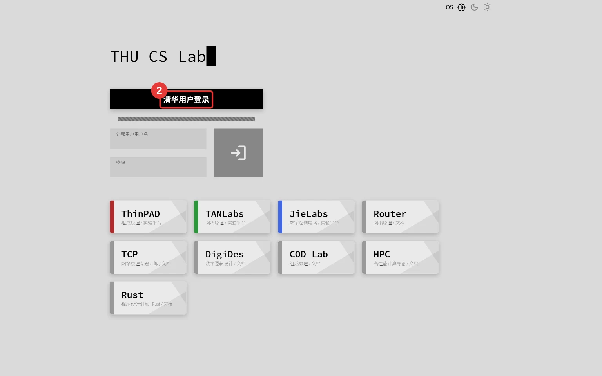{ width="640" style="border: 1px solid #d1d5db; box-shadow: 0 2px 6px rgba(0, 0, 0, 0.12); box-sizing: border-box" }](img/platform_oauth.webp)

3. 在清华大学用户电子身份服务系统中，输入学号和密码（图中 3），点击 **登录**，按页面提示完成认证。

    [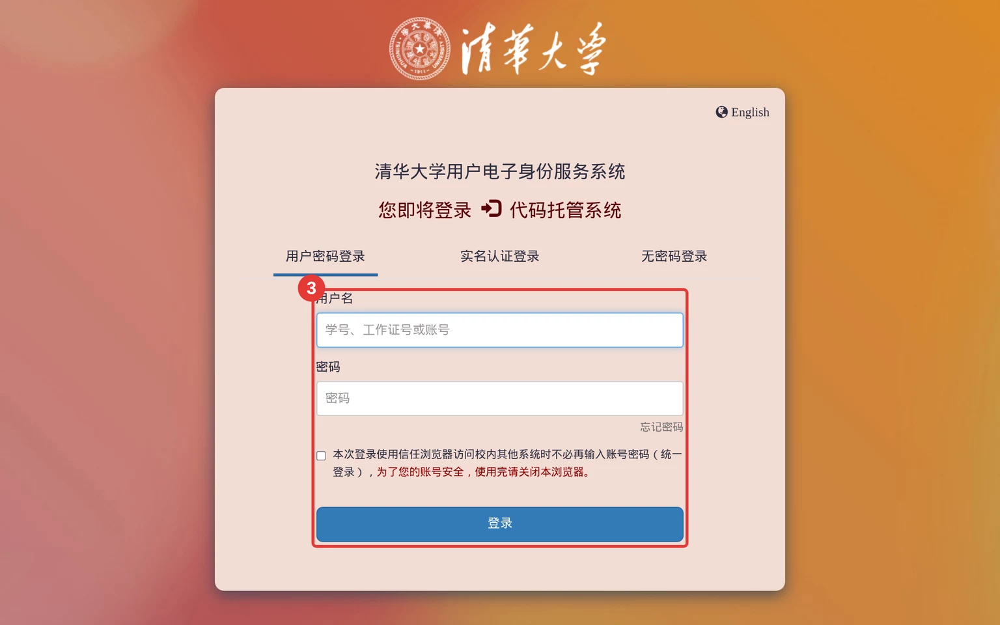{ width="640" style="border: 1px solid #d1d5db; box-shadow: 0 2px 6px rgba(0, 0, 0, 0.12); box-sizing: border-box" }](img/platform_thu_login.webp)

## 申请与连接交换机

**Request** 用于申请交换机的使用权。登录后，在首页选择空闲交换机，点击 **Request**（图中 1）即可申请。

[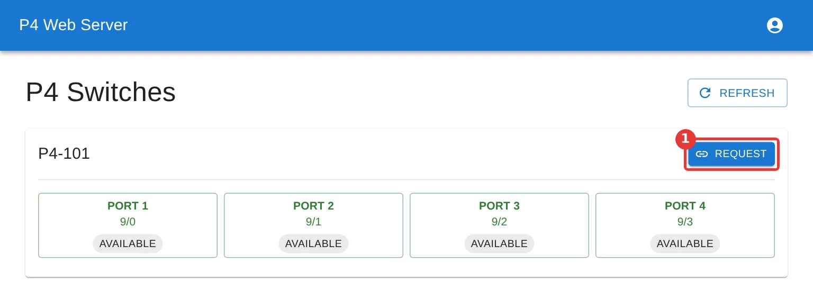{ width="640" style="border: 1px solid #d1d5db; box-shadow: 0 2px 6px rgba(0, 0, 0, 0.12); box-sizing: border-box" }](img/platform_request_home.webp)

若交换机上尚无对应的用户，或对应用户未配置公钥时，平台会要求先提交 SSH 公钥。在 **SSH Public Keys** 中粘贴本机 SSH **公钥**（图中 2），每行一个，再点击 **Request**（图中 3）。公钥通常位于 `~/.ssh/id_ed25519.pub` 或 `~/.ssh/id_rsa.pub`。请勿填写私钥。交换机 SSH 使用公钥认证，不接受密码认证。

[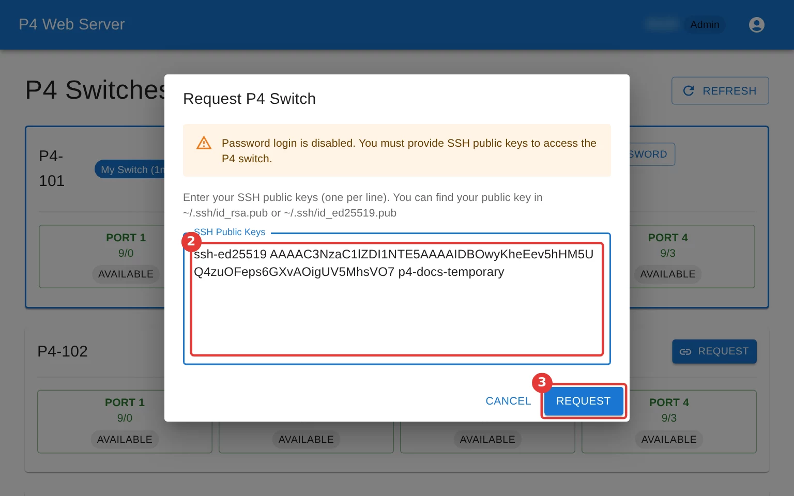{ width="640" style="border: 1px solid #d1d5db; box-shadow: 0 2px 6px rgba(0, 0, 0, 0.12); box-sizing: border-box" }](img/platform_request_first.webp)

首次创建用户后会显示 **Initial Password**。该密码只显示一次，请妥善保存，再点击 **I've Saved It**（下图 1）。首次登录时按提示修改密码。密码通常用于 sudo 认证，SSH 连接仍只能使用前面提交的公钥。

[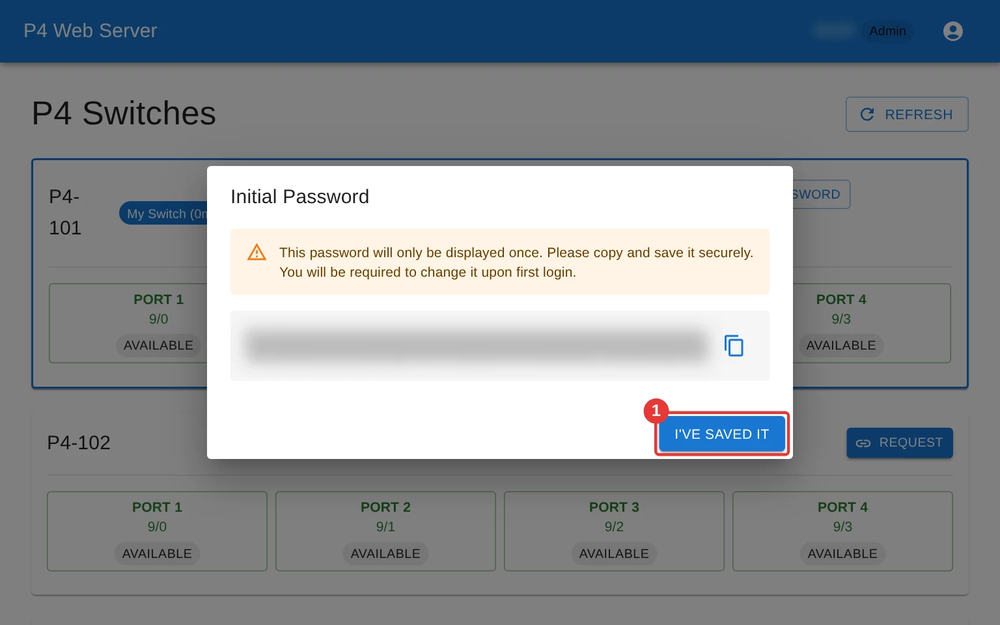{ width="640" style="border: 1px solid #d1d5db; box-shadow: 0 2px 6px rgba(0, 0, 0, 0.12); box-sizing: border-box" }](img/platform_initial_password.webp)

申请成功后，卡片显示 **My Switch（已占用时长）**。复制 SSH 命令在本机终端执行，就可以登录交换机，进行 P4 程序开发和控制。

[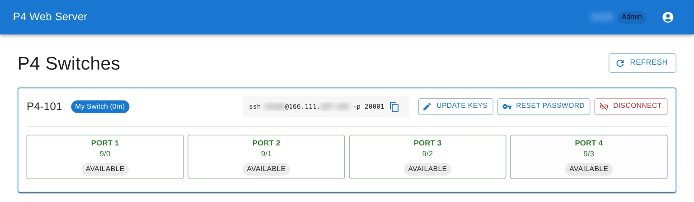{ width="640" style="border: 1px solid #d1d5db; box-shadow: 0 2px 6px rgba(0, 0, 0, 0.12); box-sizing: border-box" }](img/platform_switch_access.webp)

更换电脑或密钥后，可通过 **Update Keys** 更新公钥。提交的列表会替换已有公钥，仍需使用的公钥也要一并填写。**Reset Password** 用于重置交换机用户密码。

交换机上已有对应用户和公钥时，再次申请交换机会沿用已有公钥，直接显示连接信息。

## 创建端口容器

点击交换机卡片中的 **PORT** 按钮，为对应端口创建实验主机容器。例如，在两个端口分别创建容器，就可以从两台主机收发包，检验 P4 程序是否能正确转发包。

1. 按实验拓扑填写容器的 IPv4 / IPv6 地址和前缀长度（图中 1）。
2. 选择 **Trunk Interface**，即承载容器实验流量的宿主机网卡。同一网卡上的容器共享全双工 10 Gbit/s 带宽，流量彼此隔离。一般保持默认即可。若要测吞吐性能，建议选用没有其他容器占用的独立网卡，避免共享带宽影响结果。没有空闲网卡时可联系助教协调。
3. 需要联网时，勾选 **Enable Bridge Network**（图中 2），容器会额外有一张经 NAT 联网的网卡。该选项仅在有桥接网络权限时显示，如有需求请联系助教申请。需要从外部访问容器内服务时，还可以联系助教申请端口转发权限。获得权限并勾选桥接网络后，会显示 **Port Forwarding Rules**，可将宿主机端口映射到容器端口。
4. 点击 **Create**（图中 3），进入该容器的网页终端。

[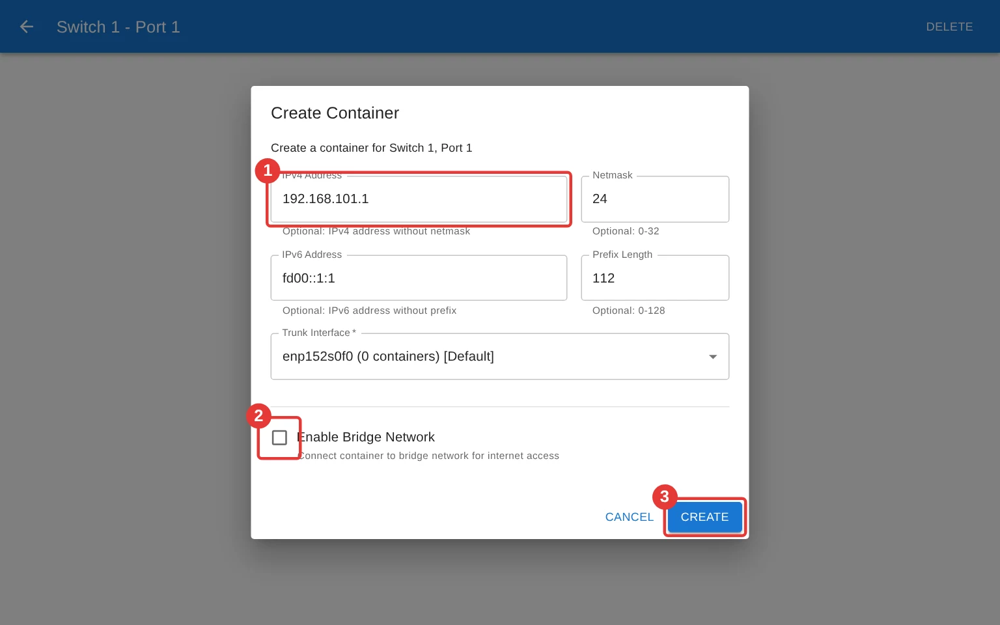{ width="640" style="border: 1px solid #d1d5db; box-shadow: 0 2px 6px rgba(0, 0, 0, 0.12); box-sizing: border-box" }](img/platform_create_container.webp)

目前容器是基于 **Alpine Linux** 的网络实验环境。销毁容器后，自行安装的软件也会丢失。若希望预装实验所需的软件，可以联系助教。

## 使用容器终端

容器创建后会自动进入网页终端。网页终端中操作与在本地终端中类似，可以用 `ip -c a` 查看主机地址，用 `ping` 测试连通性，用 `tcpdump` 抓包等。容器主要用于数据平面交互操作，P4 交换机上的程序开发和控制仍需要通过之前所述的 SSH 连接进行。

[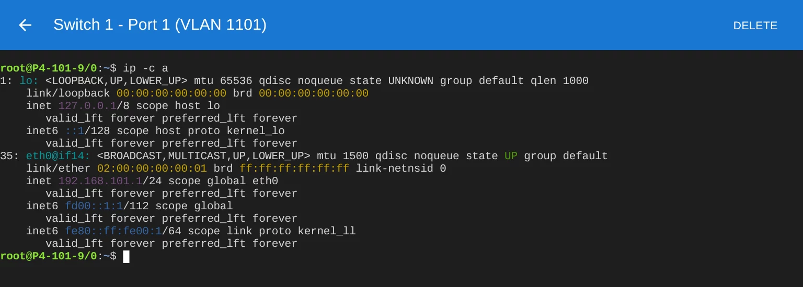{ width="640" style="border: 1px solid #d1d5db; box-shadow: 0 2px 6px rgba(0, 0, 0, 0.12); box-sizing: border-box" }](img/platform_terminal.webp)

退出时有两种选择：

| 选择 | 操作 |
| --- | --- |
| 保留容器 | 点击左上角返回，仅离开终端，之后可以继续连接 |
| 销毁容器 | 点击右上角 **Delete**，或在 shell 提示符处按 **Ctrl+D**、执行 `logout` / `exit` |

销毁后容器内文件也会丢失，请提前保存需要的实验代码和抓包结果。

## 管理容器

点击右上角头像，选择 **My Containers**，可查看自己的容器。

| 按钮 | 用途 |
| --- | --- |
| **Connect** | 重新进入已有实验容器 |
| **Files** | 浏览容器文件，上传测试脚本、下载抓包等实验结果。上传和下载分别需要对应权限，未开通请联系助教申请 |
| **Delete** | 删除实验容器及其文件，释放对应端口资源 |

[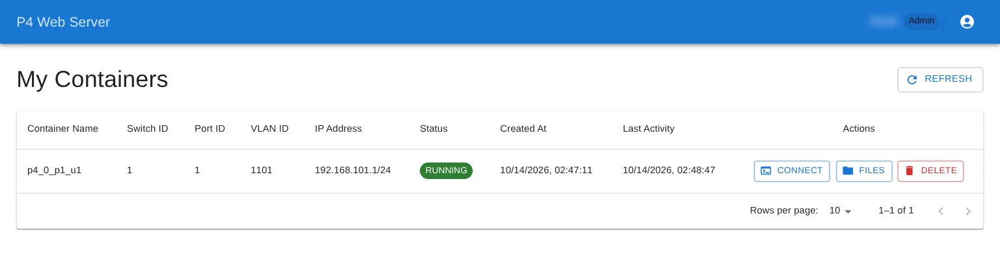{ width="640" style="border: 1px solid #d1d5db; box-shadow: 0 2px 6px rgba(0, 0, 0, 0.12); box-sizing: border-box" }](img/platform_my_containers.webp)

## 结束实验

先保存实验代码、抓包等需要保留的文件，再完成以下两步，释放容器和交换机资源。

1. 在 **My Containers** 中，逐一点击自己所有容器的 **Delete**（图中 1）并确认，直到容器列表为空。容器内的文件会一并删除。

    [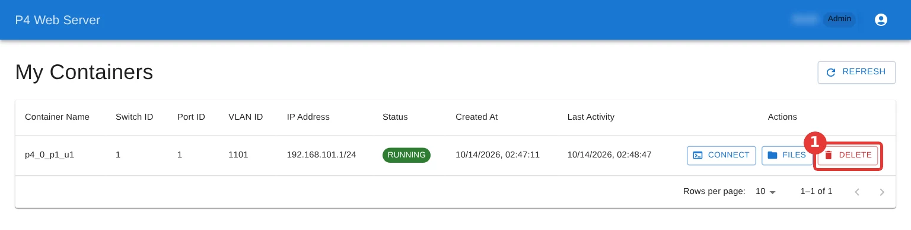{ width="640" style="border: 1px solid #d1d5db; box-shadow: 0 2px 6px rgba(0, 0, 0, 0.12); box-sizing: border-box" }](img/platform_end_containers.webp)

2. 回到首页，对每台标有 **My Switch** 的 P4 交换机点击 **Disconnect**（图中 2），再在弹窗中确认。这会关闭该交换机上的 SSH 会话并撤销访问权限。确认首页不再有 **My Switch**，完成释放。

    [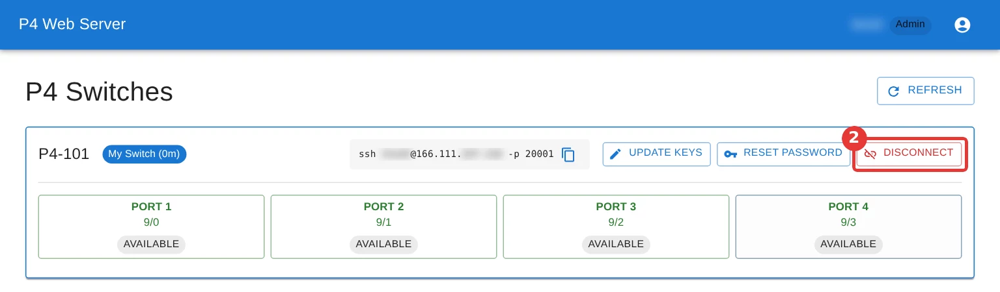{ width="640" style="border: 1px solid #d1d5db; box-shadow: 0 2px 6px rgba(0, 0, 0, 0.12); box-sizing: border-box" }](img/platform_end_switch.webp)
