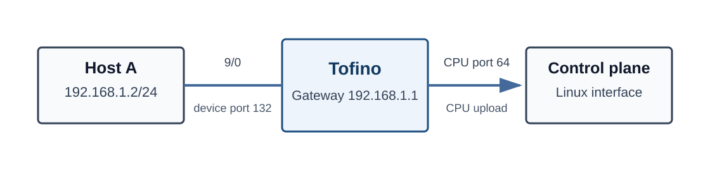

# Lab 1：黑盒观察与调试

在本节实验中，实验者将运行一个已经编译好的 Tofino 程序，通过主机抓包、CPU 接口抓包、交换机端口计数器和控制面日志观察数据包的处理结果。

本实验不需要编写或编译 P4/C 代码。实验者需要分别发送 ARP、UDP 和 ICMP 报文，并根据观测结果判断报文被交换机回复、丢弃或上传至控制面的条件。

## 实验目标

* 运行已经编译好的 Tofino 程序并检查端口状态；
* 使用 `tcpdump` 对比 ARP Request 与交换机生成的 ARP Reply；
* 发送 UDP 探测报文，并结合 CPU 接口抓包和控制面日志定位触发 CPU upload 的端口；
* 使用 ICMP 作为对照流量，理解 CPU upload 依赖的协议字段。

## 实验环境

本实验只使用 Host A。Tofino 的 `9/0` 端口配置为网关 `192.168.1.1`，控制面预先写入静态端口信息，不执行动态 ARP 学习。



| 组件 | 配置 |
|---|---|
| Host A | `192.168.1.2/24` |
| 网关 | `192.168.1.1` |
| Front-panel port | `9/0` |
| Device port | `132` |
| CPU port | `64` |

## 实验步骤

各步骤的记录要求见实验目录中的 `README.md`，报告模板为同目录下的 `report.md`。

### 1. 运行交换机程序

`p4-blackbox-observe` 目录提供预编译控制面程序 `contrl`、校验文件 `SHA256SUMS`、启动脚本 `run_switch.sh`、UDP 探测脚本和报告模板，不提供数据面和控制面源码，无需运行 `make`。`observe` 数据面的编译产物已预先部署在实验机的 SDE 中。

登录 Tofino 交换机，加载课程 SDE 环境并确认 `SDE_INSTALL` 指向安装目录。进入 `p4-blackbox-observe` 目录，检查文件完整性并设置动态库搜索路径：

```bash
sha256sum -c SHA256SUMS
export LD_LIBRARY_PATH="$SDE_INSTALL/lib${LD_LIBRARY_PATH:+:$LD_LIBRARY_PATH}"
ldd ./contrl
```

`ldd` 输出不应出现 `not found`。随后运行启动脚本：

```bash
./run_switch.sh
```

脚本启动 `contrl`，由它以库模式启动 `bf_switchd`、加载 `observe`、开启 `9/0` 并下发表项，日志写入本目录的 `observe.log`。终端出现以下输出后开始测试：

```text
[CPU] interface=... status=READY
```

`interface=` 后的名称就是交换机控制面 Linux 上的 CPU 接口，下文记为 `<cpu-interface>`。例如输出 `interface=enp4s0f0` 时就使用 `enp4s0f0`，不要填写 Host A 的 `eth0`。

### 2. 配置实验主机

在 Host A 上配置接口地址和默认路由：

```bash
ip link set eth0 up
ip addr replace 192.168.1.2/24 dev eth0
ip route replace default via 192.168.1.1 dev eth0
ip -br addr show dev eth0
ip route
```

接口应显示 `UP` 和 `LOWER_UP`。如果显示 `LOWERLAYERDOWN`，应先检查端口容器是否正确连接到 Tofino `9/0`，此时继续发送报文不会得到有效的实验结果。

### 3. 启动抓包与日志

在 Host A 启动抓包，不加过滤条件：

```bash
tcpdump -i eth0 -Q inout -nn -e -vvv -XX
```

在 Tofino 交换机上分别观察 CPU 接口和控制面日志：

```bash
tcpdump -i <cpu-interface> -nn -e 'ether proto 0x0866' -vvv -XX
tail -f observe.log
```

### 4. 观察 ARP 报文

清空邻居缓存并查询网关地址：

```bash
ip neigh flush all
arping -c 1 -I eth0 192.168.1.1
```

抓包中应同时出现 ARP Request 和 ARP Reply。比较两个报文的以下字段：

| 字段 | ARP Request | ARP Reply |
|---|---|---|
| Ethernet source/destination MAC | Host A / broadcast | 网关 / Host A |
| ARP opcode | request | reply |
| ARP sender IP | `192.168.1.2` | `192.168.1.1` |
| ARP target IP | `192.168.1.1` | `192.168.1.2` |

随后查询一个不是网关的地址：

```bash
ip neigh flush all
arping -c 1 -I eth0 192.168.1.254
```

记录请求已发出的证据、等待时间和应答情况，结合请求/应答地址和实验拓扑解释两次结果的差异。

### 5. 观察 CPU Upload

某个 UDP destination port 会触发 CPU upload，该端口位于 `10000` 至 `10031` 之间。请通过探测和观测自行找出这个端口，不要依赖其他实验组或历史运行的结果。

先发送一个普通 UDP 报文作为对照：

```bash
python3 scripts/send_udp.py --iface eth0 \
    --src-ip 192.168.1.2 --dst-ip 192.168.1.1 \
    --src-port 40000 --dst-port 9998 --payload normal
```

再运行扫描脚本。脚本从 `192.168.1.2:40001` 向 `192.168.1.1` 的 UDP 端口 `10000` 至 `10031` 各发送一个探测报文；接口不是 `eth0` 时用 `--iface` 指定：

```bash
python3 scripts/scan_udp_ports.py
```

运行时观察 `observe.log` 和 CPU 接口抓包。只有一个端口会产生类似以下的日志：

```text
[UPLOAD] ingress=132 proto=UDP ...
```

找到后，使用 `send_udp.py` 向该端口单独发送一次报文，对照 Host A 抓包、CPU 抓包和 `[UPLOAD]` 日志。命中的报文不会返回 Host A，而是被转换为 EtherType `0x0866` 的 upload 报文送到 CPU port。日志中的 `length` 对应原 IPv4 报文的 total length，不是 UDP length；日志不打印 payload 内容。EtherType 需要从两端抓包中读取。

### 6. ICMP 对照

```bash
ping -c 1 -W 1 192.168.1.1
```

记录 ICMP 的发送结果以及同一时段的 CPU 抓包和日志。ICMP 没有传输层端口，结合协议字段解释它是否会触发 CPU upload。

## 实验验证

完成实验后，应能够根据外部观测整理出以下三条报文路径：

| 输入报文 | 观测结果 |
|---|---|
| 查询 `192.168.1.1` 的 ARP Request | 交换机生成 ARP Reply 并返回 Host A |
| 普通 UDP 报文 | Host A 和 CPU 均未收到相应报文 |
| 命中隐藏 destination port 的 UDP | 转换为 EtherType `0x0866` 的报文并上传 CPU |

路径图只标出外部观测支持的收发关系，不能从“未收到”推断具体的内部丢弃位置。每项结论应引用发送端、接收端或 CPU 日志等至少两类证据，并附上每项测试前后 `9/0` 端口的 RX/TX 计数器增量。增量中可能包含 Host A 自动发出的 IPv6 邻居发现报文（Neighbor Solicitation、Router Solicitation）、MLD 组播监听报告和 ARP 请求等非测试报文，需结合同一时段的 Host A 抓包逐个核对。

## 结束实验

清空 Host A 的邻居缓存：

```bash
ip neigh flush all
```

在运行 `./run_switch.sh` 的终端按 `Ctrl-C` 停止控制面。重复运行时，建议每次启动前删除旧日志：

```bash
rm -f observe.log
```
