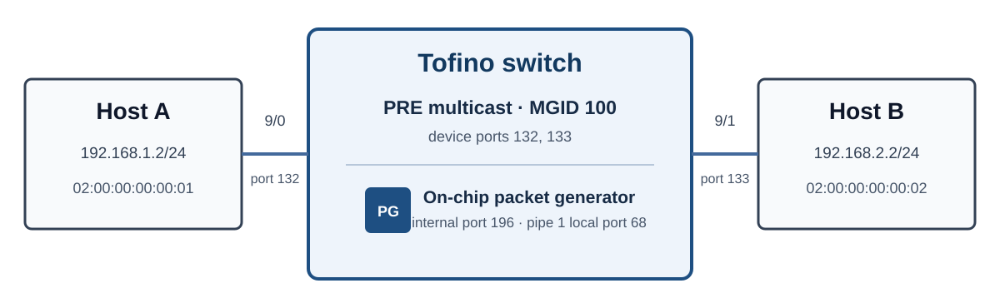

# Lab 4：复制、重提交与包生成

在本节实验中，实验者需要补全 P4 数据面和控制面程序，使 Host 报文经过 resubmit 后由 PRE 复制到两个出口，并使用 Tofino packet generator 从交换机内部产生测试报文。

## 实验目标

* 使用 PRE 将一个报文复制到多个出口端口；
* 使用 resubmit metadata 在两次 ingress pass 之间传递信息；
* 配置 one-shot packet generator，一次生成 5 个报文；
* 根据 ingress counter 和 egress counter 检查报文的处理路径。

## 实验环境



实验报文为 Ethernet/IPv4/UDP，UDP destination port 为 `10004`。UDP payload 的前 8 byte 为：

| Field | Width | Host event | Pktgen event |
|---|---:|---:|---:|
| `magic` | 32 bit | `0x4c414234`（`LAB4`） | 相同 |
| `origin` | 8 bit | `1` | `2` |
| `reserved` | 8 bit | `0` | `0` |
| `sequence` | 16 bit | `100` | `0..4` |

## 数据平面处理流程

Host A 发送的 event 经过两次 ingress pipeline：

```text
Host A event
  → ingress pass 1：保存 event 字段并执行 resubmit
  → ingress pass 2：读取 resubmit metadata 并选择 MGID 100
  → PRE：复制到 device port 132 和 133
```

Packet generator 产生的 event 只经过一次 ingress pipeline：

```text
Pktgen event
  → parser：提取 timer header
  → ingress：将 packet_id 写入 sequence，并选择 MGID 100
  → PRE：复制到 device port 132 和 133
```

MGID 100 对应的 PRE 配置为：

```text
multicast group 100
  → multicast node（RID 1）
  → device ports 132、133
```

MGID 是交换机内部使用的组播组编号，不是 IPv4 组播地址。Multicast node 也是 PRE 的配置对象，不是一台网络设备；它保存该组播组使用的出口端口集合。

## 实验步骤

### 1. 配置 PRE Multicast

PRE（Packet Replication Engine）位于 ingress pipeline 和 egress pipeline 之间，根据 P4 数据面指定的 MGID 建立报文副本。

在 `ctrl/controller.c` 中找到 `TASK 4.1`，完成以下配置：

1. 在 port bitmap 中加入 device port `132` 和 `133`；
2. 创建 MGID 为 `100` 的 multicast group；
3. 创建 RID 为 `1` 的 multicast node；
4. 将 node 关联到 group 100，并提交配置。

在 `switch/replication_pktgen.p4` 的 `TASK 4.1` 中，将单播出口设置为无效值，并将 `mcast_grp_a` 设置为 `LAB4_MGID`。

PRE 会为两个端口各建立一个 replica。每个 replica 随后独立进入 egress pipeline，并根据实际 egress port 改写 destination MAC。

### 2. 实现 Resubmit

Resubmit 将报文从 ingress 末端送回 ingress parser。Resubmit metadata 只在交换机内部传递，不会出现在 Host 收到的报文中。

在 `switch/replication_pktgen.p4` 和 `switch/parser.p4` 的 `TASK 4.2` 中完成：

1. 第一个 pass 将 `marker`、`origin` 和 `sequence` 写入 8-byte resubmit metadata，并设置 `resubmit_type`；
2. Parser 根据 `resubmit_flag` 进入 `parse_resubmit`，提取 metadata 后继续解析原报文；
3. 第二个 pass 验证 metadata，并执行 PRE multicast；
4. 第二个 pass 不再 resubmit，避免形成循环。

### 3. 配置 Packet Generator

Packet generator 是 Tofino 芯片内部的报文源。控制面将 Ethernet frame 模板写入硬件 buffer，再配置 Pktgen application：

| 参数 | 配置值 | 实际含义 |
|---|---:|---|
| Application ID | `1` | 本实验使用的 application |
| Trigger | one-shot timer | 每次启动触发一次 |
| `batch_count` | `0` | 1 个 batch，使用 `N - 1` 编码 |
| `packets_per_batch` | `4` | 每个 batch 生成 5 个报文，使用 `N - 1` 编码 |
| Device port | `196` | Pktgen 使用的内部 device port |
| Local port | `68` | 同一端口在 pipe 1 内的编号 |

在 `ctrl/controller.c` 的 `TASK 4.3` 中写入报文模板并配置 application，初始化完成后保持 application 为 disabled。执行 `pktgen start` 时再启动一次 one-shot 生成。

Pktgen 会在模板前添加 6-byte timer header。在 `switch/parser.p4` 和 `switch/replication_pktgen.p4` 的 `TASK 4.3` 中完成：

1. Parser 提取 timer header；
2. 将 event 的 `origin` 设置为 `2`；
3. 将 `packet_id` 写入 `sequence`；
4. 选择 MGID 100，将 event 复制到两个 Host。

Timer header 不由 deparser 输出，因此不会出现在 Host 收到的报文中。

### 4. 编译与运行

完成前面的 P4 和控制面修改后，在 Tofino 交换机上进入 `p4-replication-pktgen` 目录：

```bash
make
./contrl
```

控制面完成端口、PRE 和 Pktgen 配置后，应输出：

```text
[MULTICAST] mgid=100 ports=132,133 status=READY
[PKTGEN] app=1 port=196 count=5 status=READY
[CONTROL] status=READY
lab4>
```

修改程序后，先输入 `quit` 或按 `Ctrl-C` 停止当前控制面，再重新运行 `make` 和 `./contrl`。

### 5. 配置实验主机

在 Host A 上运行：

```bash
ip link set eth0 down
ip link set eth0 address 02:00:00:00:00:01
ip link set eth0 up
ip addr replace 192.168.1.2/24 dev eth0
```

在 Host B 上运行：

```bash
ip link set eth0 down
ip link set eth0 address 02:00:00:00:00:02
ip link set eth0 up
ip addr replace 192.168.2.2/24 dev eth0
```

使用 `ip -br link show dev eth0` 确认两端接口均为 `UP` 和 `LOWER_UP`。

## 实验验证

### 1. 验证 Host Event

先在控制器中清零 Counter：

```text
lab4> clear counters
```

在 Host A 和 Host B 分别启动：

```bash
# Host A
python3 scripts/verify_host_a.py host

# Host B
python3 scripts/verify_host_b.py host
```

随后在 Host A 的另一个终端发送一个 event：

```bash
python3 scripts/send_host_event.py
```

两个 Host 均应收到 `origin=1`、`sequence=100` 的报文。执行 `show counters` 后应得到：

```text
[COUNTER] original packets=1 ...
[COUNTER] resubmit packets=1 ...
[COUNTER] pktgen   packets=0 ...
[COUNTER] invalid  packets=0 ...
[COUNTER] replica  packets=2 ...
```

### 2. 验证 Packet Generator

再次执行 `clear counters`，并在两个 Host 分别启动：

```bash
# Host A
python3 scripts/verify_host_a.py pktgen

# Host B
python3 scripts/verify_host_b.py pktgen
```

在控制器中运行：

```text
lab4> pktgen start
lab4> show pktgen
lab4> show counters
```

每个 Host 应收到 5 个报文，`origin=2`，`sequence` 依次为 0 至 4。Counter 应为：

```text
[COUNTER] original packets=0 ...
[COUNTER] resubmit packets=0 ...
[COUNTER] pktgen   packets=5 ...
[COUNTER] invalid  packets=0 ...
[COUNTER] replica  packets=10 ...
```

Pktgen 产生 5 个 ingress packet，每个报文由 PRE 复制到两个出口，因此共有 10 个 egress replica。

需要检查线上报文时，可在两个 Host 上运行：

```bash
tcpdump -ni eth0 -e -vvv -XX 'udp dst port 10004'
```
