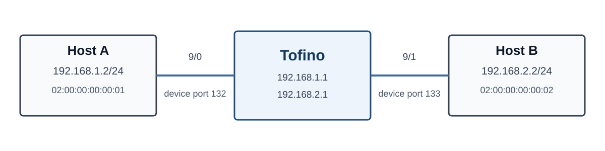

# 第二阶段：Tofino 交换机基础操作

在本阶段中，实验者将在真实 Tofino 交换机上完成四个基础实验，学习数据包观察、IPv4 转发动作、有状态数据平面以及 Tofino 特有的报文处理机制。

四个实验使用统一的端口配置、控制面程序和测试脚本。完成程序后，应通过主机抓包、交换机端口计数器和控制面输出检查数据平面的实际行为。

## 实验内容

| 实验 | 主要内容 | P4 程序 |
|---|---|---|
| [Lab 1：黑盒观察与调试](./tofino_lab1_observe.md) | ARP、CPU upload、抓包与日志分析 | 使用编译好的程序 |
| [Lab 2：IPv4 单跳处理](./tofino_lab2_ipv4.md) | IPv4 LPM、TTL 递减与 checksum 更新 | 补全数据平面程序 |
| [Lab 3：有状态流量监测](./tofino_lab3_stateful.md) | Hash、Register、Counter 与 Digest | 补全数据平面程序 |
| [Lab 4：复制、重提交与包生成](./tofino_lab4_replication.md) | PRE multicast、resubmit 与 packet generator | 补全数据平面程序 |

实验代码位于 [`p4-lab2-basic-tofino-operation`](https://git.tsinghua.edu.cn/p4-lab/p4-lab2-basic-tofino-operation) 仓库。完成实验时，请同时参考本实验指导书和仓库中各实验目录下的 `README.md`。各实验分别位于以下目录：

```text
p4-lab2-basic-tofino-operation/
├── p4-blackbox-observe/
├── p4-ipv4-action/
├── p4-stateful-monitor/
└── p4-replication-pktgen/
```

## 实验环境

| 组件 | 配置 |
|---|---|
| 交换机 | Tofino 1 |
| SDE | Intel/Barefoot SDE 9.13 |
| Host A 端口 | front-panel port `9/0`，device port `132` |
| Host B 端口 | front-panel port `9/1`，device port `133` |
| CPU port | device port `64` |

Lab 1 只使用 Host A；Lab 2、Lab 3 和 Lab 4 使用 Host A 与 Host B。双主机实验的拓扑如下：



开始实验前，在主机中检查接口状态：

```bash
ip -br link show dev eth0
ip -br addr show dev eth0
```

接口应显示 `UP` 和 `LOWER_UP`。如果显示 `LOWERLAYERDOWN`，需要先检查实验平台中的端口容器和交换机端口状态。

## 编译与运行

Lab 2、Lab 3 和 Lab 4 均使用以下命令编译并启动程序：

```bash
make
./contrl
```

`make` 编译 P4 数据平面和 C 语言控制面程序。`contrl` 启动 `bf_switchd`、加载 P4 pipeline、开启实验端口并配置实验所需的 BF-RT 对象。控制面输出 `status=READY` 后即可开始发包。

同一台交换机同时只能运行一个 `bf_switchd` 实例。切换实验或重新编译前，应先在控制器中输入 `quit`，或按 `Ctrl-C` 停止当前程序。

## 报文观察

主机侧可以使用 `tcpdump` 观察 Ethernet header 和各层协议字段：

```bash
tcpdump -ni eth0 -e -vvv -XX
```

在 Tofino 的 port manager 中，可以使用 `show` 命令检查端口状态和 RX/TX packet counter：

```text
bfshell> ucli
bf-sde> pm
bf-sde.pm> show
```

排查报文转发问题时，依次检查发送端、Tofino ingress port、数据平面 counter、Tofino egress port 和接收端。这样可以确定报文是在进入交换机前、ingress pipeline、egress pipeline 还是主机接收阶段出现异常。
